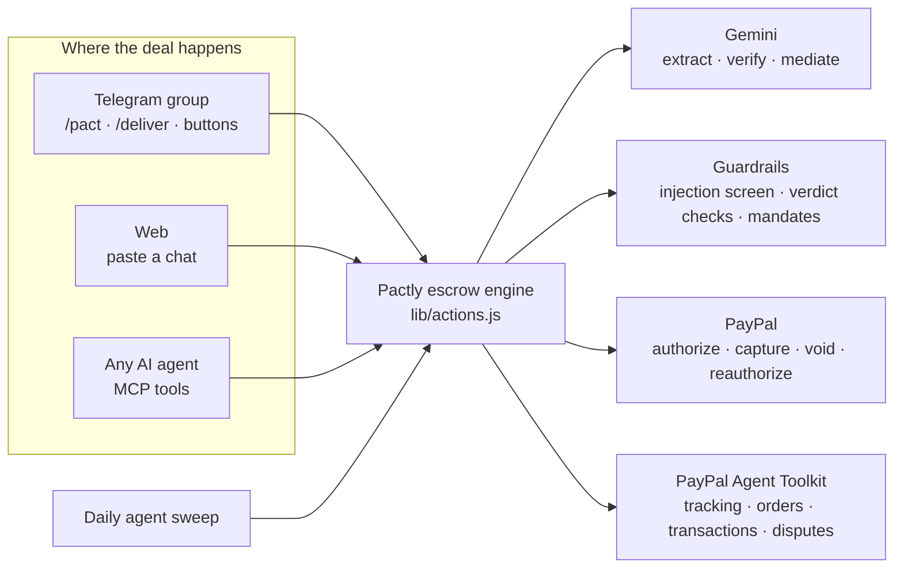

# Pactly — AI escrow for deals made in chats

**Pactly turns any informal deal into a PayPal-backed escrow pact, right where the deal is made: inside a Telegram group, from a pasted WhatsApp chat, or from an AI agent over MCP. PayPal holds the money; an AI agent checks the work; the money moves only inside rules the AI can't bend.**

Freelancers and small sellers close millions of deals in chats. Either the buyer pays first and risks a scam, or the seller works first and risks never being paid. Formal escrow is far too heavy for a $120 logo job. With Pactly it's one message: `/pact`.

**Why it matters**
- Americans lost **$2.7B** to scams that began on social media since 2021; **44%** of reports in H1 2023 were shopping scams, mostly goods never delivered ([FTC data via Security Boulevard](https://securityboulevard.com/2023/10/ftc-american-lost-2-7-billion-since-2021-to-social-media-scams)).
- **62%** of New York freelancers have lost wages to non-paying clients, and fewer than **1%** pursued legal action ([Authors Guild / Freelancers Union survey, 2022](https://authorsguild.org/news/survey-finds-62-percent-of-ny-freelance-workers-have-lost-wages-due-to-nonpayment)).

## Try it in 2 minutes (for judges)
- **Live demo:** https://pactly-vert.vercel.app
- **Start here: [Try it](https://pactly-vert.vercel.app/try).** A group chat in your browser that runs the **same bot engine** as the Telegram integration. Play Riya (buyer), Arjun (seller) and Eve (a stranger) with one-tap suggested messages and a checklist: agree a deal → the bot offers to protect it → claim roles → fund with the real PayPal sandbox → deliver (sample logo images are generated for you) → watch the seller's own "Release" tap get refused → release as the buyer → attack the AI verifier and watch the payout freeze. No Telegram account needed.
- **Control room:** open **Control room**. Demo pacts load automatically and show every state: a blocked prompt-injection attack, an AI agent that hired a human over MCP, a renewed PayPal hold, a Telegram goods deal with tracking, a scam chat blocked before payment, a dispute, an auto-voided deadline. Try **Ask your ledger** (“Which deals need my decision?”).
- **Telegram:** **Connect → Add the bot to a group**, chat a deal, say “deal 👍”, and follow the buttons.
- **AI agents:** **Connect** shows the MCP server URL and copy-paste config for Claude, Claude Code and Cursor.
- **Live PayPal flow on the web:** New pact → *Use sample chat* → *Draft pact with AI* → pay with the PayPal button using a **US sandbox personal account** → switch to *Seller* and submit work → switch to *Buyer* and settle.
- **Sandbox buyer login (fake money, safe to share):**
  - Email: `sb-fonqm53381183@personal.example.com`
  - Password: `K)&3+uHc`
- Tip: use an incognito window so PayPal doesn't reuse another login. Use a US sandbox buyer; PayPal blocks some same-country payments (for example India to India) even in sandbox.

## How it works

1. **Chat → contract.** Pactly reads the conversation (any language, Hinglish included) and extracts parties, price, milestones, deadlines, *objectively checkable* acceptance criteria and a scam-risk score with specific red flags. In Telegram, the bot notices when a deal is agreed (“deal 👍” plus a price) and offers to protect it.
2. **Pay → hold.** The buyer pays with PayPal using an order with `intent: AUTHORIZE`: the money is **held**, not paid out. From the web via the JS SDK button; from Telegram or an agent via a PayPal-hosted approval link.
3. **Deliver → verify.** The seller submits notes, links, photos and shipment tracking (`/deliver` in Telegram). A multimodal model checks every criterion and recommends release / partial / hold, explaining each check.
4. **Settle.** The buyer's tap **captures** that milestone's share of the authorization (partial captures, `final_capture` on the last). For goods, the tracking number is registered on the PayPal capture through the **PayPal Agent Toolkit**.
5. **Disputes.** A mediator agent proposes a split; it settles as a partial capture once **both** parties accept.
6. **The agent acts on its own, only in the safe direction.** Missed deadline → it **voids** the authorization and the buyer is refunded. PayPal's 3-day honor period over → it **reauthorizes** the hold once so long deals stay protected. A day before a deadline → it reminds the seller in the chat.

## The money rules (enforced in code, not in the prompt)
| Rule | Where |
|---|---|
| Funding always needs a human approving in PayPal | `order` / `order-redirect` + `authorize` in `lib/actions.js` |
| In Telegram, only the person who claimed **buyer** can release, ask for fixes or cancel; nobody can be both buyer and seller | `onButton` in `lib/telegram.js` |
| An AI agent (MCP) can release only if the buyer granted a mandate at checkout, never above the verifier's certified %, never on a flagged delivery | `approve` in `lib/actions.js` |
| Everything a seller submits is untrusted: it's fenced for the model and screened for prompt injection; a hit forces **hold 0%** and disables agent release | `lib/guard.js` |
| A verdict must be internally consistent: no 100% unless every criterion passed; 0 criteria met → 0% | `enforceVerdict` in `lib/guard.js` |
| The autonomous agent only voids (refunds) or renews holds; it never pays out | `lib/agent.js` |
| Money-moving Agent Toolkit tools (refunds, order capture) are not enabled; only read tools and shipment tracking | `lib/toolkit.js` |

## PayPal integration
| Capability | Used for |
|---|---|
| JS SDK Buttons (`intent=authorize`) | Buyer funds a pact on the web |
| Orders v2 — create (AUTHORIZE) with `payment_source.paypal.experience_context` | Hosted approval links for Telegram and AI-agent funding (return/cancel URLs) |
| Orders v2 — authorize | Placing the escrow-style hold |
| Payments v2 — capture (partial, `final_capture`) | Milestone releases and mediated splits |
| Payments v2 — void | Cancellations and missed deadlines return funds |
| Payments v2 — **reauthorize** | Renewing the hold after the 3-day honor period |
| Orders `payee` | Routes captured funds to the seller's PayPal account |
| **PayPal Agent Toolkit** (`@paypal/agent-toolkit`) | `create_shipment_tracking` after capture for goods deals; `get_order`, `list_transactions`, `list_disputes`, `get_dispute`, `get_shipment_tracking` as tools for the chat agent to check PayPal's own records |
| Webhooks + signature verification | Reconciling pact state with PayPal |
| `PayPal-Request-Id` on every write | Idempotency |

## AI integration
Google Gemini (`gemini-3.8-flash`, free tier) by default, with strict JSON response schemas so every decision is machine-readable; Anthropic Claude is a drop-in alternative (`AI_PROVIDER=anthropic`).
- **Pact extraction**: chat → contract, milestones, criteria, risk flags
- **Delivery verification**: multimodal check of photos + notes against each criterion, with an `injectionDetected` field
- **Dispute mediation**: proposes a fair split with reasoning
- **Conversational agent (`/agent`)**: function calling over the ledger plus PayPal Agent Toolkit tools; money actions come back as proposals with a Confirm button
- **Ask your ledger**: a question becomes an AG Grid filter + sort model, validated against a column whitelist before it reaches the grid

## Telegram bot
| | |
|---|---|
| `/pact` | Turn the conversation (or a pasted / replied-to chat) into a pact |
| `/deliver` | Seller submits work: note, links, photos, `tracking: NUMBER` |
| `/status` | What's held, released and waiting in this chat |
| Buttons | I'm the buyer / seller · Fund with PayPal · Release N% · Ask for a fix · Dispute · Accept mediation · Cancel & refund |

## MCP server
`POST /api/mcp` — Streamable HTTP, JSON responses, protocol `2025-06-18` (also `2025-03-26`, `2024-11-05`).
Tools: `create_escrow_pact`, `list_pacts`, `get_pact`, `submit_delivery`, `release_milestone`, `request_revision`, `open_dispute`, `cancel_pact`.
```bash
claude mcp add --transport http pactly https://pactly-vert.vercel.app/api/mcp
```

## AG Grid control room
AG Grid Community and AG Charts power `/dashboard`: custom cell renderers for the released/held/returned escrow bar, the PayPal hold clock (honor period countdown, “renewed” state), scam-risk meter and source badges; a pinned totals row; row rules for scams and blocked attacks; CSV export; a second grid of every money movement with PayPal ids, filtered by clicking a pact (external filter); an AG Charts stacked bar of released / held / returned money by channel (palette validated for colour-blind separation); and **Ask your ledger** driving `setFilterModel` / `applyColumnState` from natural language.

## Run locally
```bash
git clone https://github.com/guptaparin/pactly && cd pactly
npm install
cp .env.example .env.local   # sandbox credentials + free Gemini key
npm run dev                  # http://localhost:3000
```
1. Create a sandbox REST app at https://developer.paypal.com/dashboard/applications/sandbox and copy the client ID/secret (use the client ID for both `PAYPAL_CLIENT_ID` and `NEXT_PUBLIC_PAYPAL_CLIENT_ID`).
2. Pay with the sandbox **personal** account; use the sandbox **business** account email as the seller.
3. Optional: add a webhook pointing to `/api/webhooks/paypal` and set `PAYPAL_WEBHOOK_ID`.

## Tests
```bash
npm run build && npm run test:e2e
```
53 end-to-end checks run the real Next.js server against offline PayPal and Telegram mocks with a deterministic AI stub: the web escrow flow, prompt-injection blocking, all MCP tools and mandate limits, hold reauthorization and deadline voids, every Telegram role check, the chat playground, and the ledger query validator.

## Deploy (free, no card)
1. Import the repo at https://vercel.com/new (Hobby plan).
2. **Storage → Create → Upstash for Redis** (free) and connect it; this injects `KV_REST_API_URL` / `KV_REST_API_TOKEN`.
3. Add the variables from `.env.example` and redeploy. The daily agent sweep is registered by `vercel.json`.

### Telegram bot setup (5 minutes)
1. In Telegram, message **@BotFather** → `/newbot` → copy the token into `TELEGRAM_BOT_TOKEN`; set `TELEGRAM_BOT_USERNAME`.
2. `/setprivacy` → choose the bot → **Disable**, so it can read the group conversation it drafts pacts from.
3. Set `TELEGRAM_WEBHOOK_SECRET` to any random string, redeploy, then open `https://<your-app>/api/telegram/setup?key=<TELEGRAM_WEBHOOK_SECRET>` once.
4. `/api/health` shows whether PayPal, AI, storage and Telegram are configured.

## What's real and what's simulated
- **Real:** every PayPal call (sandbox orders, authorizations, captures, voids, reauthorizations, Agent Toolkit tracking), every AI call (Gemini), the Telegram bot, the MCP server and the playground's bot logic.
- **Simulated:** the playground replaces Telegram's servers with an in-app transcript (same `lib/telegram.js` code path); demo pacts in the control room are read-only examples that never touch PayPal; `npm run test:e2e` uses offline mocks.
- **Not done yet:** WhatsApp/Instagram, live (non-sandbox) payouts, seller identity verification.

## Notes and limits
- Sandbox only. PayPal honors an authorization for 3 days and it stays valid up to 29 days; Pactly reauthorizes once after the honor period, which covers deals up to about a month.
- Storage: Upstash Redis in production, JSON files locally (`lib/store.js`).

## License
MIT
